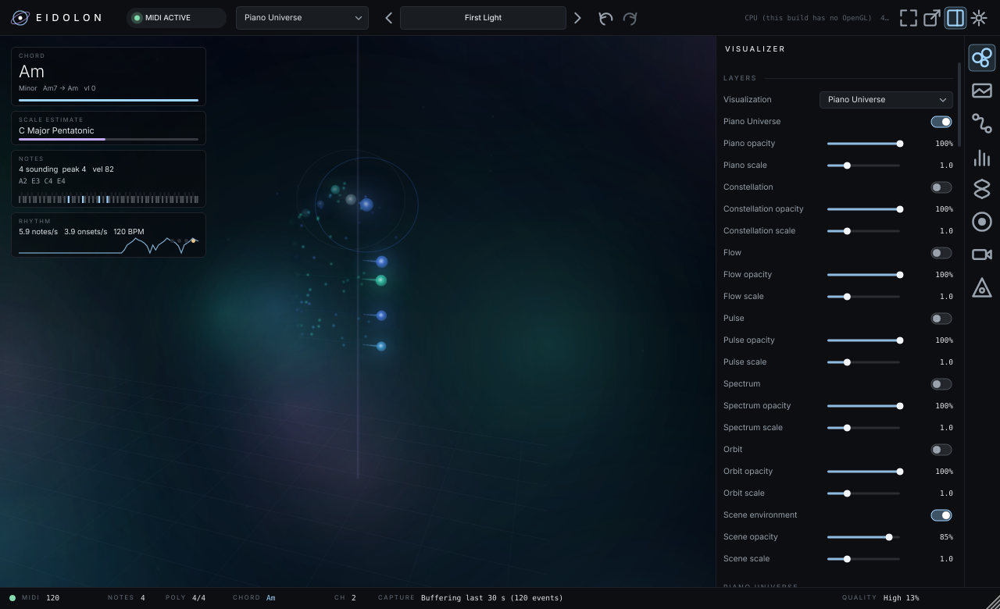

# EIDOLON — MIDI Universe Visualizer

EIDOLON turns MIDI into an evolving visual universe. Notes become 3D objects, melodies become trajectories, chords
become geometry, rhythm becomes energy, and whole passages become procedural cinematic environments — driven by a
real-time musical-intelligence engine (chords, scales, voices, rhythm, statistics).

**Format:** VST3 instrument (MIDI in, MIDI thru out, silent audio) · **Platform:** Windows 10/11 x64 ·
**Built with:** C++20, JUCE 8.0.4, CMake · **Installer:** `EIDOLON-1.0.0-Setup.exe` (Inno Setup)



## Status — what is real and what was verified

| Item | Status |
|---|---|
| Source code, CMake, build scripts, installer script, CI | complete in this repository |
| Linux build of the same sources (GCC 13, JUCE 8.0.4) | **built** — the VST3 compiles and links |
| Core tests (MIDI engine, intelligence, mapping, capture/SMF, Visual DNA) | **54 / 54 passed** — `TEST_REPORT.md` |
| VST3 host test (JUCE VST3 hosting, MIDI through processBlock, state, programs, editor, stress, shutdown) | **18 / 18 passed** on Linux under Xvfb (CPU renderer) |
| Windows x64 build (MSVC 2022, OpenGL on) | **built** by GitHub Actions (`.github/workflows/build-windows.yml`, run 44872987068) |
| Core tests on Windows (MSVC build) | **54 / 54 passed** |
| pluginval (Tracktion, strictness 5, non-GUI tests) | **SUCCESS** (exit code 0) |
| `EIDOLON-1.0.0-Setup.exe` (Inno Setup 6) | **built** — contains the x64 `EIDOLON.vst3`; published to the `binaries` branch on every push to `main` |
| OpenGL (GPU) canvas | Windows build only (the Linux validation machine has no GL headers); automatic fallback to CPU |
| Inside FL Studio | **not tested by this pipeline** (no FL Studio available). Routing follows FL's documented behaviour — see `Docs/FL_STUDIO_ROUTING.md`. |

## Install (Windows)

1. Download `EIDOLON-1.0.0-Setup.exe` from the repository's **`binaries`** branch (or the latest **Actions** run →
   artifact *EIDOLON-Setup-Windows-x64*).
2. Run it. It installs `EIDOLON.vst3` to `C:\Program Files\Common Files\VST3\` (an uninstaller is registered).
3. FL Studio: **Options → Manage plugins → Find installed plugins**. EIDOLON appears under **Generators**.
4. Add EIDOLON to the **Channel Rack** and play its Piano Roll or your keyboard. Use a **Layer** channel to drive EIDOLON
   and an instrument with the same notes. Details: [`Docs/FL_STUDIO_ROUTING.md`](Docs/FL_STUDIO_ROUTING.md).

The status pill in the top bar shows **NO MIDI YET / MIDI ACTIVE / MIDI IDLE** and is driven only by events that
actually arrived — EIDOLON never fakes activity.

## Features
* **Seven visualization modes that run together as layers**: Piano Universe (11 geometries, 6 materials, lifecycle,
  trails, attraction, clustering, collisions), Constellation (relationship graph + chord geometry + progression ghosts),
  Flow (per-voice melodic trajectories), Pulse (rhythm energy), Spectrum (MIDI statistics), Orbit (pitch-class orbits),
  Cinematic (10 procedural scenes with 8 transition types and 12 musical triggers).
* **MIDI engine**: note lifecycle (active → sustained → released → visual decay), all 16 channels, CC 0–127, pitch bend,
  channel pressure, poly aftertouch, sustain, program change, MIDI clock, channel filter, event history, overflow
  protection, stuck-note recovery, panic.
* **Musical intelligence**: chord recognition (29 templates + custom, inversions, bass, root, confidence, temporal
  stabilization, transition history, voice leading), probabilistic scale estimation, voice tracking (6 modes, reports
  ambiguity), rhythm (onset rate, density, tempo, beat / bar from host, MIDI clock or estimate), windowed statistics.
* **Mapping editor**: any MIDI source → any visual parameter with ranges, dead zone, sensitivity, inversion, 5 curves
  (incl. draggable custom), 4 response types, smoothing, MIDI learn, documented arbitration.
* **Visual DNA**: full-identity presets (JSON), 20 factory presets, categories / favorites / recents / search,
  import / export, reproducible seeded mutation with preserved groups, variations, undo / redo.
* **Capture**: live buffer, fixed, triggered, phrase and loop capture; timeline; internal replay; Standard MIDI File
  export; drag a take out as `.mid`.
* **Camera**: static / orbit / follow / follow active notes / follow musical centre / cinematic / automatic; orbit,
  pan, zoom, reset.
* **Rendering**: GPU through JUCE's OpenGL renderer on Windows with CPU fallback, quality presets, FPS target,
  adaptive quality, performance overlay; focus mode and a pop-out window with full screen.
* **Persistence**: everything (DNA, mappings, analysis / capture / render settings, window size and tab) is saved
  with the project; versioned, forward-compatible JSON.

See [`Docs/USER_GUIDE.md`](Docs/USER_GUIDE.md) and [`Docs/ARCHITECTURE.md`](Docs/ARCHITECTURE.md).

## Build from source
See [`BUILD.md`](BUILD.md). Short version on Windows (Visual Studio 2022 with *Desktop development with C++*, CMake,
Git; Inno Setup 6 optional): run `build_windows.bat`.

## Known limitations (honest list)
* All drawing goes through `juce::Graphics`; with OpenGL it is GPU-rasterized, but there are no custom shaders.
  Layer blending is alpha compositing with per-layer opacity (no additive blend modes).
* The plugin window cannot enter exclusive full screen inside a host; use the pop-out window (F / F11).
* UI scaling = freely resizable layout + the host's DPI scaling (no separate zoom factor).
* Voice separation and scale detection are heuristics and say so in the UI; chord recognition is template-based.
* EIDOLON cannot create a MIDI track in FL Studio by itself: export or drag the captured `.mid`.
* VST3 hosts rarely send MIDI clock; tempo comes from the host transport (or is estimated from notes).
* The CPU fallback is considerably slower than the GPU path; adaptive quality reduces detail to stay responsive.

## Repository layout
```
CMakeLists.txt         build (fetches JUCE 8.0.4 unless EIDOLON_JUCE_PATH is set)
Source/                Core, MIDI, Intelligence, Mapping, Capture, DNA, Rendering, Visualization, Scenes, Engine, Plugin, UI
Tests/                 CoreTests.cpp (JUCE-free), HostTest.cpp (VST3 host validation + screenshots)
installer/EIDOLON.iss  Inno Setup script -> dist/EIDOLON-1.0.0-Setup.exe
Resources/Fonts        Inter (OFL) and DejaVu Sans Mono
Docs/                  routing, user guide, architecture, screenshots
build_windows.bat      one-step Windows build (+ setup.exe when Inno Setup is installed)
install_windows.bat    copies the built bundle to the system VST3 folder
```

## License
See [`LICENSE`](LICENSE). EIDOLON uses JUCE 8, which is available under the AGPLv3 or a commercial JUCE licence —
if you distribute EIDOLON binaries, make sure your JUCE licensing covers it.
